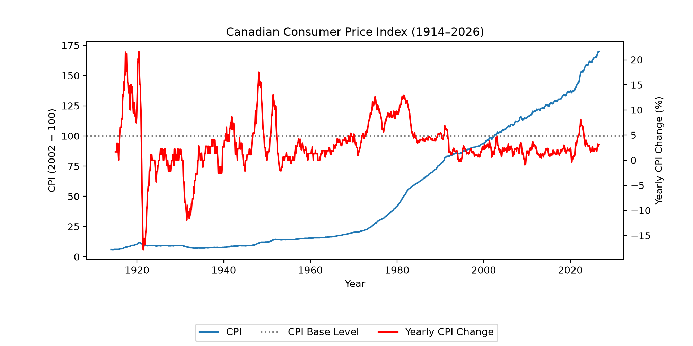

# FINE 3300 — Assignment 2: Consumer Price Index and Inflation Calculator

**Student :** Faiza Tasnim Khandaker

## Project Overview
This project was completed for the FINE 3300: Python for Finance Professionals course at Schulich School of Business. It uses monthly Canadian Consumer Price Index (CPI) data from the Bank of Canada to examine how prices have changed over time. I created a graph showing the CPI and its yearly percentage change, as well as an inflation calculator based on the Bank of Canada's online calculator. Unlike the website, which only accepts years, my calculator accepts months (YYYY-MM) as well.

## Project Files
- **InflationCalculator.py:** Python program that reads and prepares the CPI data, calculates yearly CPI changes, creates and saves the graph, and runs the inflation calculator by prompting inputs from users.
- **STATIC_INFLATIONCALC.csv:** Monthly CPI data downloaded from the Bank of Canada, covering January 1914 to September 2026.
- **CPI_Inflation_Graph.png:** Graph generated by the CPI program as required in the assignment.
- **README.md:** Project overview, instructions, graph, sample output, and notes.

## How the Program Works
I divided the program into four main functions, each responsible for a different part of the project:
1. **Reading and preparing the data:** I used pandas to read the Bank of Canada CPI data into a DataFrame. I also removed repeated monthly entries to keep one CPI observation per month.
2. **Calculating yearly CPI changes:** I used a NumPy array and a for loop to compare each month's CPI with the CPI from 12 months earlier. The yearly percentage changes are then added to the DataFrame.
3. **Creating the graph:** Using Matplotlib, I plotted the CPI over time on the left axis and its yearly percentage change on the right axis. I also added a dotted line at the CPI base level of 100 (2002 = 100). The graph is automatically saved as a PNG file.
4. **Building the inflation calculator:** The program asks users to enter an original price in CAD and two dates in YYYY-MM format. It checks the inputs, finds the corresponding CPI values, and calculates the inflation-adjusted price, percentage change, difference in years, and average annual rate of change. The results are displayed with appropriate rounding and currency formatting. I also allowed users to compare dates in either direction, including an ending date earlier than the starting date, so they can calculate how prices have changed both forward and backward in time. To ensure accurate results, the program uses the CPI values corresponding to the selected dates, keeps the time difference positive using abs(), and handles identical dates separately to avoid division by zero when calculating the annual rate of change.

## How to Run and Replicate the Results
1. To download the project, click Code → Download ZIP on this GitHub repository and extract the downloaded folder.
2. Install Python 3 and the required libraries. Make sure python, pandas, NumPy, and Matplotlib are installed. If needed, install them in the terminal using: python -m pip install pandas numpy matplotlib. The program also uses pathlib, which is included with Python and does not need to be installed separately.
3. Keep InflationCalculator.py and STATIC_INFLATIONCALC.csv in the same extracted folder.
4. Run the Python program. Open the extracted project folder in Visual Studio Code and run InflationCalculator.py. 
5. Enter the required inputs. The program will prompt users to enter:
   - The original price in Canadian dollars (e.g., 1,000)
   - The starting month and year in YYYY-MM format (e.g., 2001-01)
   - The ending month and year in the same format (e.g., 2025-12)
6. View the results. The calculator displays the starting and ending CPI values, time difference in years, adjusted price, percentage change, and average annual rate of change. The program also automatically creates and saves CPI_Inflation_Graph.png in the project folder. The saved graph can be opened to view the CPI trends. To open the graph in Matplotlib while running the program, remove the # before plt.show() in Part 3 of the code.
Please Note: The calculator uses the CPI data included in this repository, covering January 1914 to September 2026. Both selected dates must be available in the dataset.

## How to Modify the Project
Users can open InflationCalculator.py in Visual Studio Code or another Python editor to make changes. For example, they can adjust the graph title, labels, or plotting style in Part 3, or change the calculator's prompts and output formatting in Part 4. To compare different prices or months, no code changes are needed as the program can be run again with new entered values. The CPI data comes from the external Bank of Canada CSV file, STATIC_INFLATIONCALC.csv. If users replace it with an updated download, they should keep the same filename and expected columns (date and STATIC_INFLATIONCALC), ensure the observations are monthly and in chronological order, and check whether the number of introductory lines still matches skiprows=8 in Part 1. I used skiprows=8 because the first eight rows contain introductory information rather than the monthly CPI observations. The program does not download new CPI data automatically.

## CPI Graph and Observations

The graph shows that the CPI has increased substantially over time, from 6.0 in January 1914 to 170.0 in September 2026. However, the yearly percentage change is much less steady, with sharp fluctuations in the earlier decades, peaking at about 21.6% in 1920 before turning into deflation of about -17.8% in 1921, and prices fell again in the early 1930s. Inflation was high again in the mid-1970s and early 1980s (about 12-13%) and reached about 8.1% in 2022. One interesting distinction is that even when the yearly inflation rate falls, the CPI can still remain higher than it was a year earlier, showing that as long as the annual inflation rate remains positive, prices are still higher than in the same month of the previous year, even if they are increasing more slowly.

## Sample Calculator Output
For an original price of CAD $1,000, comparing January 2001 with December 2025:

**Enter the original price (CAD): 1000**

**Enter the starting month and year (YYYY-MM): 2001-01**

**Enter the ending month and year (YYYY-MM): 2025-12**

**Starting CPI: 96.3**

**Ending CPI: 165.0**

**Difference in years: 24.92**

**Adjusted price: CAD $1,713.40**

**Percentage change: 71.34%**

**Average Annual Rate Of Change: 2.18%**

The CPI-adjusted price is calculated using the ratio of the ending CPI to the starting CPI. The average annual rate also accounts for the number of months between the selected dates.

## Data Preparation and Limitations
- The Bank of Canada CSV has information above the actual observations, so skiprows=8 is used to read the table correctly.
- While checking the monthly dates, I found repeated entries for April 1927 and April 1932. The two April 1927 entries were identical (9.0), but the April 1932 entries differed (7.6 on 1932-04-01 and 7.4 on 1932-04-30). I used drop_duplicates() to keep the first entry for each month (so 7.6 for April 1932), which leaves one observation per month and makes the 12-month comparison work correctly.
- Pathlib is used to locate the CSV and save the graph relative to the Python file. This helps the program work even if it is run from a different working directory.
- The calculator checks for common invalid inputs, including text or negative prices and dates not found in the dataset. It accepts commas and spaces in prices, but does not check whether commas are placed correctly or reject special numerical values.
- Results depend on the data in the included CSV file, which ends in September 2026 and the calculator is not connected to a live data feed.
- The first 12 months have no year-over-year percentage change because the dataset does not contain the preceding year for comparison.

## Data Source and Reference
[Bank of Canada — Inflation Calculator](https://www.bankofcanada.ca/rates/related/inflation-calculator/). This page provides the CPI dataset, calculation approach, and the 2002 = 100 base-period reference used as the baseline for the graph.
